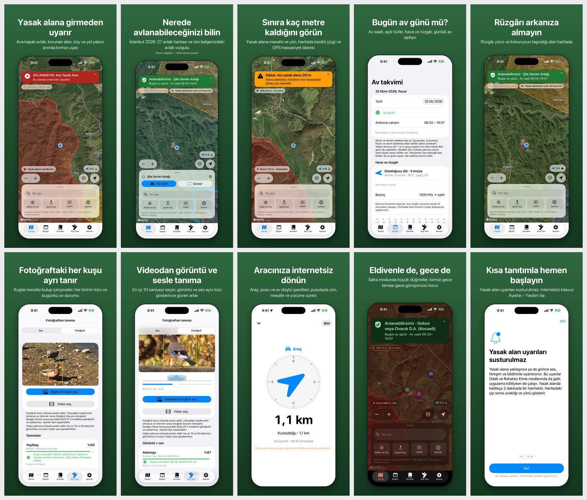
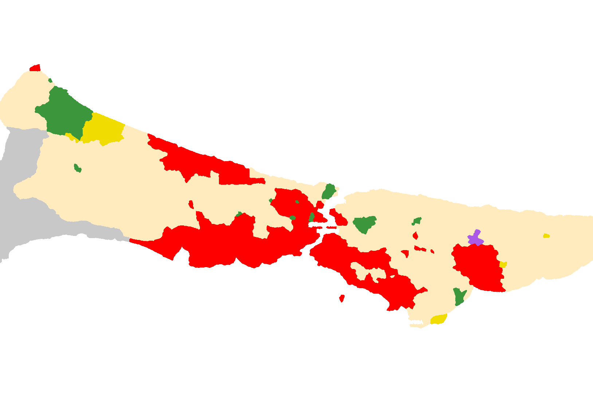

# Av Haritası (iOS)

İstanbul'daki avcılar için bir iPhone uygulaması. Konumunuzu Tarım ve Orman Bakanlığı'nın avlak haritası üzerinde
gösterir; bulunduğunuz yeri ve anı **2026-2027 Merkez Av Komisyonu (MAK) kararına** göre (yer, zaman, tür)
değerlendirir ve yasak bir alana yaklaştığınızda ya da girdiğinizde sizi uyarır. Kuşu sesinden, fotoğrafından ya da
videosundan tanır; tüfeğinize ve avlayacağınız türe göre şok ve saçma önerir. **Yalnızca İstanbul** için ve
**internetsiz** çalışır.

> **Durum:** Deneme (beta) sürümü **v0.9.1**. Derleme ve birim testleri her değişiklikte GitHub
> Actions'ta (Xcode 26) koşar. 1.0.0, gerçek cihazla saha testinden sonra App Store'a çıkacak sürümdür.
> Sürüm notları: [`CHANGELOG.md`](CHANGELOG.md).



- Kullanım kılavuzu: [`docs/KILAVUZ.md`](docs/KILAVUZ.md) · English: [`docs/USER_GUIDE.md`](docs/USER_GUIDE.md) ·
  web sitesi: <https://oguzbay-del.github.io/harita-veri/>
- Gizlilik: [`docs/GIZLILIK.md`](docs/GIZLILIK.md) · [`docs/PRIVACY.md`](docs/PRIVACY.md)

> **Uygulama resmi değildir.** Yasal sorumluluk avcıya aittir. Sınırlar birkaç yüz metre sapabilir; yeşil durum,
> avcılık belgesi, izin kartı, AVBİS izni ve limit yükümlülüklerini kaldırmaz.

## İstanbul 2026-2027 özeti

| | |
|---|---|
| Av günleri | Çarşamba, Cumartesi, Pazar ve resmi tatiller. Salı: yaban domuzu, 1. ve 3. grup kuşlar |
| Av saati | Gün doğumundan 1 saat önce – gün batımından 1 saat sonra |
| 1. grup kuş (bıldırcın, üveyik) | 18.08 – 15.11.2026 |
| 3. grup kuş (ördekler, çulluk, ardıç, güvercin…) | 24.10.2026 – 07.03.2027 |
| 4. grup kuş (karga, saksağan, karabatak) | 18.08.2026 – 07.03.2027 |
| Tavşan, tilki | 10.10.2026 – 03.01.2027 |
| Yaban domuzu, çakal | 18.08.2026 – 07.03.2027 |
| Keklikler | İstanbul'da **tüm keklik türleri yasak** |
| Ava kapalı avlak | **Sarıkavak Devlet Avlağı** (ayrıca Kocaeli Gebze D.A.) |
| Mesafe yasakları | Yerleşim, mesire, KGM yolu, gölet ve korunan alanlara 300 m; askeri alan, okul, sağlık tesisi, cezaevi ve özel avlaklara 500 m |

Günlük limitler ve tüm ayrıntılar uygulamanın **Bugün** ve **Kurallar** sekmelerinde.

Kaynaklar: **34 İstanbul Avlaklar Haritası 2026-2027** (taranmış görüntü, `maps/34_istanbul_2026_2027_orijinal.pdf`;
aynı şablonla basılmış 2024-2025 GeoPDF'ine hizalanarak koordinatlandırıldı) ve **2026-2027 Av Dönemi MAK Kararı**,
Resmî Gazete 07.06.2026 (`maps/mak_2026_2027.pdf`).

## Ne yapar?

Uygulamada beş sekme var: **Harita, Bugün, Kurallar, Kuş Tanı, Ayarlar.**

### Harita ve uyarılar

- Üstteki **durum şeridi** bulunduğunuz yerin ve anın durumunu söyler; dokununca tüm kural kontrolleri listelenir:
  - 🟥 **Avlanmayın:** yasak alan, korunan alanın 300 m yakını, köy, mesire yeri ya da karayoluna 300 m'den yakın,
    kapalı avlak, av günü değil, av saati dışı.
  - 🟧 **Dikkat:** sınıra yakın, örnek avlak, yeri belirsiz yasak alan, asfalt yol, köyün dış evleri olabilir,
    GPS doğruluğu düşük ya da konum eski (1,5 dakikadan eski konumla asla "avlanabilirsiniz" denmez).
  - 🟩 **Avlanabilirsiniz:** devlet veya genel avlak, mesafe kurallarına uygun, bugün av günü ve av saati içinde.
- **Yasak alan uyarıları susturulmaz:** ses, titreşim ve Zamana Duyarlı bildirim; Odak/Rahatsız Etme modlarında,
  ekran kilitliyken ve Face ID uygulama kilidi açıkken de gelir. Yaklaşma mesafesi 100–1000 m arası seçilir (yasal
  300/500 m kuralları her zaman uygulanır). **Uygulama kapalıyken uyarı** CLMonitor "güvenli daire" ile çalışır.
- Avlak bölgeleri resmi 2026-27 haritasından **vektöre çevrilmiş** yarı saydam alanlar olarak çizilir; taranmış
  resmi harita Katmanlar'dan isteğe bağlı açılır. İsteğe bağlı **300 m yasak bantları** (karayolları, köy ve ilçe
  merkezleri, mesire yerleri); okul, sağlık tesisi, askeri alan gibi yerler OpenStreetMap verisinden.
- Haritanın sağ kenarındaki ince **cam araç sütunu:** Katmanlar, İşaret koy, İz kaydı, Konum, + / − ve Acil durum.
- Haritaya **uzun basınca** o noktanın değerlendirmesi açılır (gitmeden önce plan için).
- **Altlıklar:** Apple Uydu+yol / Uydu / Standart, OpenTopoMap ve OpenStreetMap (gezilen karolar önbelleğe alınır).
  **Çevrimdışı İstanbul topo haritası:** genel görünüm uygulamayla gelir, ayrıntılı kısım (≤150 MB) kullanıcı
  isteyince GitHub Releases'ten indirilir (kaldığı yerden devam, SHA-256 doğrulaması). İnternet yokken çevrimdışı
  altlığa kendiliğinden geçilir.
- **Yer arama:** köy, ilçe, mesire ve avlak adları internetsiz (Türkçe harf duyarsız), internet varsa Apple Haritalar.
- **Rüzgâr rozeti ve koku konisi:** kokunuzun rüzgârla taşındığı alan haritada çizilir.
- **Avlak ve izin belgesi:** AVBİS "Avlanma İzin Belgesi"nin ekran görüntüsü, fotoğrafı ya da PDF'i telefonda
  okunur (Vision OCR / PDFKit): avlak, geçerli gün, türler ve kotalar. Ad soyad ve belge numaraları saklanmaz. Avlak
  haritada vurgulanır, en yakın kenarına yol tarifi açılır; o gün av defteri belgedeki kotayla çalışır.

### Bugün

- Seçilen günün av günü olup olmadığı, konuma göre av saati, açık türler ve günlük limitler, sonraki av günleri.
- **Hava ve rüzgâr** (Open-Meteo): yön (Poyraz, Lodos…), hız, hamle, sıcaklık, yağış, 12 saatlik rüzgâr şeridi;
  son tahmin internetsiz de görünür. **Av saati hatırlatmaları** (başlangıç, bitişe az kala, bitiş).
- **Bugünkü avım / av defteri:** her açık tür için +/− sayaç; MAK limitleri (ördeklerde grup toplamı ve tür
  sınırları birlikte) uygulanır, limit dolunca + kapanır. Her güne isteğe bağlı **tüfek ve fişek notu**.
- **Ava hazırlık:** avlanacağınız türleri (yalnızca o gün açık ve İstanbul'da yasal olanlar) ve isterseniz araziyi
  seçin; uygulama tüfeklerinizden **1. ve 2. tercihi**, her namlu için **şoku**, **saçma numarası (mm), gramajı,
  kurşun/çelik** ve fişek boyunu önerir, "Neden bu?" ile gerekçesini ve nişan/etik notunu gösterir. MAK ve güvenlik
  kuralları (domuz avında yalnız tek kurşun, yivli tüfek kuş ve tavşanda yok, fişek boyu ≤ yatak, çelik saçmada şok
  sınırı, korunan türler hiç önerilmez…) öneriden önce uygulanır. **Kontrol listesi:** belge ve tezkere, AVBİS izni,
  takoz (2+1), limitler, fişekler. Tüfekler **Ayarlar › Tüfeklerim**'den girilir (en çok 6).

### Kurallar

İstanbul için 2026-27 değişiklikleri, mesafe yasakları, avlaklar (açık/kapalı), korunan alanlar ve önemli yasaklar
(tüfek ve fişek, gece görüş, araç, sürek avı…); her kuralın yanında madde numarası. Sonunda internetsiz **saçma ve
şok başvuru tablosu:** tür → saçma/şok/mesafe, saçma no ↔ mm, şok no ↔ ad, çelik saçma kuralları, patern denemesi.

### Kuş Tanı

- **Ses:** 15 sn kayıt telefonda **BirdNET V2.4** (Core ML, 333 İstanbul türüne indirgenmiş) ile çözümlenir; tahmin
  İstanbul'da o hafta bulunabilecek türlerle süzülür.
- **Fotoğraf ve video:** **kuş bulucu** (YOLOX-S, kuşa ince ayarlı) fotoğraftaki kuşları bulur, her biri kırpılıp
  **tür modeliyle** (EfficientNetV2-S, 331 tür, testte %84,6 ilk tahmin) tanınır; farklı türden birden fazla kuş
  ayrı listelenir. Videoda kuşlu bölüm taranır. Ayrıntı: [`docs/KUS_FOTO_MODELI.md`](docs/KUS_FOTO_MODELI.md).
- Sonuçta türün bugünkü MAK durumu görünür: *bugün avlanabilir / sezon dışı / İstanbul'da yasak / koruma altında /
  av türü değil*. Korunan bir tür av türüne yakın skorluysa sonuç "Emin değil" diye işaretlenir.
- **Belirsiz sonuçta isteğe bağlı çevrimiçi kontrol:** telefondaki model emin değilse ve internet varsa yalnızca
  seçilen fotoğraf ya da ses kaydı (konumsuz) tanıma sunucusuna (Cloud Run; BioCLIP 2 + Perch v2,
  [`tools/kus_sunucu`](tools/kus_sunucu)) gönderilir ve saklanmaz. Ayarlar › Kuş tanıma'dan kapatılır.

### Saha araçları ve diğer

- **İşaretler** (araç, pusu, av düştü, su/kaynak, not) ve pusulalı **yönlendirme**; **iz kaydı**; ikisi de GPX olarak
  paylaşılır. **Acil durum** ekranı: büyük koordinat, doğruluk, en yakın yerleşim, tek dokunuşla 112, konum paylaşma.
- **Saha modu** (eldivenle kullanım için büyük düğme ve yazı, ekran açık) ve **gece (kırmızı) teması**.
- **Kilit ekranı / Dynamic Island** (Live Activity), ana ekran aracı, **Apple Watch** uygulaması ve komplikasyonu,
  **Siri** kısayolları ("Av Haritası burada avlanabilir miyim").
- Pusuda hareketsizken GPS hassasiyeti kendiliğinden düşer (pil). Uyarı sesleri gerçek kuş kayıtları (Xeno-canto).
- **Face ID / Touch ID uygulama kilidi** (yalnızca ekranı gizler, uyarıları durdurmaz).
- Uygulama içi **kullanım kılavuzu** ve ilk açılış tanıtımı (Ayarlar › Yardım), **geri bildirim gönderme**.
- **Türkçe / İngilizce:** tüm arayüz, kural metinleri, tür adları ve bildirimler; İngilizce kural ekranında "hukuken
  geçerli olan Türkçe metindir" notu.

### Gizlilik ve internet

Her şey internetsiz çalışır. İnternete yalnızca şunlar için çıkılır: hava tahmini (yaklaşık konum, ~1 km),
isteğe bağlı çevrimiçi kuş tanıma kontrolü, anonim kullanım istatistiği (TelemetryDeck; kimlik, tam konum ve yasak
alan bilgisi gönderilmez) ve kullanıcının kendisinin gönderdiği geri bildirim. Son ikisi ve çevrimiçi kontrol
Ayarlar'dan kapatılır. Konum, izler, işaretler, av defteri, izin belgesi ve tüfekler yalnızca telefonda kalır.

## Teknoloji

| Seçenek | Karar | Gerekçe |
|---|---|---|
| **SwiftUI + MapKit** (iOS 17+, iOS 26'da Liquid Glass) | ✅ | Ek bağımlılık ve API anahtarı yok, ücretsiz. Arka planda konum ve bildirim en güvenilir şekilde native çalışıyor. Özel karo katmanı ve çokgen çizimi destekleniyor. **Swift paketi kullanılmıyor.** |
| **Core ML** (BirdNET, kuş bulucu, tür modeli) | ✅ | Tanıma telefonda, internetsiz; Neural Engine'de hızlı. |
| OpenStreetMap / OpenTopoMap | ✅ Altlık | Arazi için en faydalı altlık (patika, eş yükselti). Görüntülenen karolar önbelleğe alınır; toplu indirme yapılmaz (OSM kullanım politikası). Çevrimdışı topo paketi OSM + Copernicus DEM'den kendimiz üretiyoruz. |
| Apple Uydu | ✅ Altlık | Orman ve tarla sınırlarını görmek için. |
| Google Maps SDK | ❌ | API anahtarı ve faturalandırma gerektiriyor; karoların çevrimdışı saklanmasına lisans izin vermiyor. |

## Veri hattı

```
maps/34_istanbul_2026_2027_orijinal.pdf  (taranmış JPEG, koordinatsız)
  └─ tools/georef_scan.py (2024-25 GeoPDF'ine OpenCV ECC ile hizalama, korelasyon 0,998)
       → maps/34_istanbul_2026_2027.pdf (GeoPDF)
       └─ tools/generate_assets.py --scan → istanbul_2026_2027.zones.bin / .tiles / .json
            └─ tools/vectorize_zones.py → istanbul_2026_2027.vectors.json (keskin çokgenler, ızgarayla IoU ≥ 0,99)
maps/34_istanbul_2024_2025.pdf  (vektörlü GeoPDF, WGS84)
  └─ tools/extract_features.py → *.features.json (köy/ilçe/mesire, karayolu/asfalt), *.units.bin (avlak birimleri)
maps/mak_2026_2027.pdf  (463 sayfa, taranmış)
  ├─ tools/ocr_pdf.py → docs/mak_2026_2027_ocr.txt
  └─ elle yapılandırıldı → ios/AvHaritasi/MapData/mak_2026_2027.json
OpenStreetMap (okul, sağlık, askeri alan…) → tools/osm_layer.py (osm-veri iş akışı)
OSM + Copernicus DEM → tools/render_basemap.py → çevrimdışı topo paketleri (offline-harita iş akışı)
```

`maps/34_istanbul_2026_2027.pdf` yeniden üretilebildiği için depoda tutulmuyor (`.gitignore`). Belgenin nasıl
bölümlendiği ve okunduğu: [`docs/MAK_2026_2027_okuma.md`](docs/MAK_2026_2027_okuma.md). Tüfek/şok/saçma bilgi
tablosu ve kaynakları: [`docs/AV_MUHIMMAT.md`](docs/AV_MUHIMMAT.md).

### Yeni sezon

```bash
pip install pymupdf numpy scipy pillow scikit-image opencv-python-headless
# Taranmış haritayı koordinatlandır (aynı şablonla basılmış bir GeoPDF referans olarak gerekir)
python3 tools/georef_scan.py maps/34_istanbul_2024_2025.pdf maps/34_istanbul_2026_2027_orijinal.pdf \
    maps/34_istanbul_2026_2027.pdf --check docs/hizalama.png
python3 tools/generate_assets.py maps/34_istanbul_2026_2027.pdf --scan --name istanbul_2026_2027 \
    --title "İstanbul Avlaklar Haritası" --season "2026-2027" --out ios/AvHaritasi/MapData \
    --preview docs/siniflandirma_onizleme.png
python3 tools/vectorize_zones.py ios/AvHaritasi/MapData/istanbul_2026_2027.json
# Vektörlü GeoPDF varsa --scan olmadan doğrudan; köy/yol vektörleri için:
python3 tools/extract_features.py maps/34_istanbul_2024_2025.pdf --name istanbul_2024_2025 --out ios/AvHaritasi/MapData
```

Yeni MAK kararı geldiğinde `mak_2026_2027.json` güncellenir: gruplar, tarihler, limitler, tatiller, değişiklikler.
`overrides` alanına yalnızca haritada görünmeyen ya da çok küçük kalan yasak alanlar eklenir (şu an Adalar ve
Kızılcaköy-Soğullu YHYS). Dosya adı değişirse `AppModel.swift` içindeki kaynak adlarını da güncelleyin.



*Kırmızı: ava yasak · yeşil: özel kanunla korunan · sarı: yaban hayvanı yerleştirme sahası · bej: devlet avlağı ·
gri: genel avlak · mor: örnek avlak*

## Derleme ve geliştirme (Mac + Xcode 26)

1. `ios/AvHaritasi.xcodeproj` dosyasını açın. Hedefler: *AvHaritasi*, *AvDurumWidget*, *AvSaat* (Apple Watch),
   *AvSaatKomplikasyon*, *AvHaritasiTests*.
2. *AvHaritasi* hedefi → **Signing & Capabilities** → **Team** olarak Apple kimliğinizi seçin; gerekirse Bundle
   Identifier'ı benzersiz yapın.
3. iPhone'u bağlayıp ▶︎ ile çalıştırın. İlk seferde *Ayarlar → Genel → VPN ve Aygıt Yönetimi*'nden geliştiriciye
   güvenin ve *Gizlilik ve Güvenlik → Geliştirici Modu*'nu açın.
4. Konum izni: "Uygulamayı Kullanırken"; uygulama kapalıyken uyarı için "Her Zaman".

Denetimler (her yerde çalışır; CI aynılarını koşar):

```bash
python3 tools/l10n.py && python3 tools/l10n.py --check      # çeviri katalogları: 0 eksik / 0 kullanılmayan
python3 tools/kilavuz.py && python3 tools/kilavuz.py --check  # kullanım kılavuzu ve web sitesi
python3 tools/akis_denetim.py                                 # kuş tanıma akış şeması ↔ Swift sabitleri
```

Birim testleri ve SwiftLint: `ios-build.yml` ve `lint.yml` (GitHub Actions). Sürüm: `vX.Y.Z` etiketi itilince
`surum.yml` GitHub Release açar, TestFlight da etiketle tetiklenir. Katkı kuralları: [`CLAUDE.md`](CLAUDE.md).

## ⚠️ Sınırlamalar

- **Uygulama resmi değildir.** Yasal sorumluluk avcıya aittir.
- 2026-27 haritası taranmış bir görüntü. Alanlar renkten okunuyor; çok küçük alanlar (birkaç yüz metre)
  kaybolabilir. Adalar bu yüzden ayrıca işaretlendi; Kızılcaköy-Soğullu YHYS haritada görünmediği için geniş bir
  "dikkat" alanı olarak eklendi.
- Köy/yol vektörleri ve avlak birim adları 2024-25 haritasından geliyor; 2026-27'de birim adları değişmiş olabilir.
- Harita 1:490.000 ölçekli; sınırlar birkaç yüz metre sapabilir.
- Köy mesafesi köy merkezi noktasından hesaplanıyor; köyün en dış evleri için kendi gözleminizi esas alın.
- Yol sınıfı haritadan alındı: Karayolu ve Ekspres yol KGM yolu kabul edildi, asfalt yollar "dikkat".
- Okul, sağlık tesisi, askeri alan gibi 500 m kuralı yerleri OpenStreetMap'ten gelir ve eksik olabilir.
- Av günü: resmi tatiller listede var; sonradan ilan edilecek idari tatilleri kendiniz kontrol edin.
- Kuş tanıma bir yardımdır, kesin teşhis değildir: türden emin olmadan atış yapmayın.
- Tüfek, şok ve saçma önerileri başlangıç noktasıdır; tüfeğinizi 30–35 m'de patern tahtasında deneyin.
- BirdNET (CC BY-NC-SA 4.0) ve fotoğraf modeli (CC BY-NC fotoğraflarla eğitildi) ticari olmayan kullanım içindir.

## Dosya yapısı

```
ios/AvHaritasi/
  AvHaritasiApp.swift
  Model/        Kural motoru (Assessment, Regulations), harita verisi (HuntingMap, ZoneVectors, MapFeatures),
                konum ve uyarılar (AppModel, AlertPolicy, Geofence, ProximityHaptics), altlıklar ve çevrimdışı
                harita (BaseLayers, OfflineBasemap, OfflineMapStore), hava (Weather), av defteri (HarvestLog),
                izin belgesi (HuntPermit, PermitImport), işaret ve iz (Waypoints, TrackLog), ses tanıma (BirdID),
                kilit ekranı ve saat (LiveStatus, WatchLink), istatistik ve geri bildirim (UsageStats, Feedback)
  Views/        Harita ve araç sütunu (HuntingMapView, MapToolRail), Bugün, Kurallar, Kuş Tanı, Ayarlar
  Hunting/      Tüfek, şok ve saçma önerisi: Domain (Firearm, AmmoAdvisor, PrepChecklist), Data (AvMuhimmat.json,
                FirearmStore), Presentation (Tüfeklerim, Ava hazırlık, kontrol listesi, başvuru tablosu)
  BirdPhoto/    Fotoğraf/video tanıma: BirdDetector + BirdClassifier (Core ML), çevrimiçi kontrol istemcisi
  BirdNET/      BirdNET V2.4 Core ML ve İstanbul tür listesi
  Help/         Kilavuz.json (kullanım kılavuzunun tek kaynağı)
  Intents/      Siri kısayolları
  MapData/      Üretilmiş harita ve kural verileri
ios/AvDurumWidget/        Kilit ekranı / Dynamic Island Live Activity ve ana ekran aracı
ios/AvSaat/, AvSaatKomplikasyon/   Apple Watch uygulaması ve komplikasyonu
ios/Shared/               Uygulama ve eklentilerin ortak tipleri
ios/AvHaritasiTests/      Birim testleri
tools/                    Veri hattı, çeviri, kılavuz, ekran görüntüsü araçları
  kus_foto/, kus_bulucu/  Fotoğraf modeli ve kuş bulucu eğitimi (Kaggle/Colab)
  kus_sunucu/             Çevrimiçi kuş tanıma sunucusu (Cloud Run)
docs/                     Kılavuz, gizlilik, yayın, test planı, MAK okuması, model belgeleri, web sitesi (docs/site)
maps/                     Kaynak PDF'ler
screenshots/              App Store ve uygulama ekran görüntüleri
```
