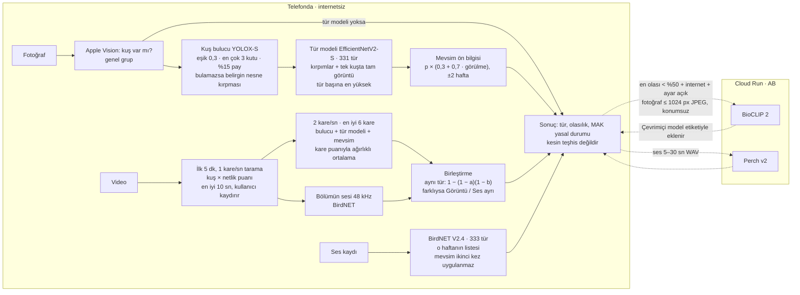

# Fotoğraftan kuş tanıma modeli (BirdClassifier.mlpackage)

`ios/AvHaritasi/BirdPhoto/BirdClassifier.mlpackage` uygulamaya gömülüdür (20,6 MB, int8 ağırlık). Fotoğraf
önce telefonda bu modelle tanınır; model emin olmazsa (en olası tür < %50) ve internet varsa çevrimiçi
BioCLIP 2'ye sorulur (tools/kus_sunucu).

## Akış şeması

Kuş tanımanın tamamı (fotoğraf, video, ses) ve çevrimiçi yedek yol. Kesik oklar yalnızca internet varken ve
Ayarlar'daki "Belirsiz sonuçlarda çevrimiçi kontrol" açıkken izlenir. Bu şema tek kaynaktır: akış değişince
burası ve aşağıdaki `akis-sabitleri` güncellenir; `python3 tools/akis_denetim.py` (CI: lint.yml) sabitleri
Swift kaynaklarıyla karşılaştırır.

<!-- akis-sabitleri: cevrimici_esik=0.5 cevrimici_foto_px=1024 cevrimici_ses_en_az_sn=5 cevrimici_ses_en_cok_sn=30 bulucu_esik=0.3 bulucu_en_cok=3 bulucu_pay=0.15 tur_sayisi=331 birdnet_tur=333 birdnet_hz=48000 mevsim_taban=0.3 mevsim_hafta=2 video_tarama_sn=300 video_tarama_fps=1 video_pencere_sn=10 video_pencere_fps=2 video_kare=6 -->



1. **Fotoğraf → kuş var mı:** Apple Vision (`VNClassifyImageRequest`) kuş olup olmadığını ve genel grubu
   (ördek, baykuş…) verir. Tür modeli uygulamada yoksa sonuç bu genel gruptur.
2. **Kuş bulucu:** YOLOX-S (`DetectionDecoder`) eşik 0,3, en çok 3 kuş, her yana %15 paylı kare kırpım. Kuş
   bulunamazsa Apple'ın belirgin nesne kırpması kullanılır.
3. **Tür:** EfficientNetV2-S, 331 tür; her kuşun kırpımı (tek kuşta ayrıca tam görüntü) sınıflandırılır, tür başına
   en yüksek olasılık alınır. Birden fazla kuşta sonucu en emin olunan kuş belirler.
4. **Mevsim:** p' ∝ p · (0,3 + 0,7 · görülme), görülme ±2 haftalık ortalama (`SeasonalPrior`).
5. **Sonuç:** tür, olasılık, MAK yasal durumu ve "kesin teşhis değildir" uyarısı.
6. **Video** (yalnızca cihazda, asla gönderilmez): ilk 5 dk 1 kare/sn taranır, kuş × netlik puanıyla en iyi 10 sn
   seçilir (kullanıcı kaydırabilir); bölümden 2 kare/sn örneklenir, en iyi 6 kare 2–4. adımlardan geçer ve kare
   puanıyla ağırlıklı ortalanır. Bölümün sesi (48 kHz) BirdNET'e gider; aynı türse güven 1 − (1 − a)(1 − b),
   farklıysa "Görüntü" ve "Ses" ayrı gösterilir.
7. **Ses:** BirdNET V2.4, 333 tür, o haftanın İstanbul listesi; mevsim ön bilgisi ikinci kez uygulanmaz.
8. **Çevrimiçi (isteğe bağlı):** en olası tür < %50 (ya da yalnızca genel grup) + internet + ayar açık → fotoğraf
   uzun kenarı ≤ 1024 px JPEG olarak, konumsuz, Cloud Run'daki BioCLIP 2'ye; ses kaydı 32 kHz WAV (en çok 30 sn,
   kısa kayıt 5 sn'ye tamamlanır) Perch v2'ye. Video hiç gönderilmez. Yanıt cihazdaki sonucun altına
   "Çevrimiçi tahmin" bölümü olarak, tahminler "Çevrimiçi model" kaynağıyla eklenir.

## Model

| | |
|---|---|
| Mimari | EfficientNetV2-S (ImageNet-21k ön eğitimli), 384×384 giriş, ince ayar |
| Türler | 331 İstanbul türü (`BirdNET_Istanbul_Weeks.json`; Puhu ve Sığır Balıkçılı için serbest lisanslı fotoğraf bulunamadı) |
| Veri | iNaturalist araştırma düzeyi gözlemler, CC0 / CC BY / CC BY-NC, 130.554 fotoğraf (önce Türkiye, sonra Avrupa) |
| Eğitim | Kaggle 2×T4 (DDP), 30 tur, BioCLIP 2 damıtma, bulanıklık/uzaklık artırımı, karıştırma (mixup/cutmix), EMA, dengeli örnekleme, sıcaklık ayarı (`tools/kus_foto`) |

## Sonuçlar (eğitimde hiç kullanılmamış 13.037 test fotoğrafı)

| Ölçü | Değer |
|---|---|
| İlk tahmin doğru | %84,6 (önceki model %81,8) |
| İlk 3'ten biri doğru | %93,4 (önceki %91,4) |
| Model ≥ %70 eminken doğruluk | %96,1 (fotoğrafların %78'i) |
| Avlanamayan kuşun av türü sanılması (≥ %70 güvenle) | %0,21 (önceki %0,43) |
| int8 sıkıştırma kaybı | 0,02 puan; Core ML ↔ PyTorch uyuşması %98,5 (macOS, `kus-foto-dogrula.yml`) |

Zor koşullarda ilk tahmin (önceki model parantez içinde): düşük çözünürlük %82 (%70), eğik %82 (%78),
karanlık %80 (%76), bulanık %79 (%57), düşük kaliteli JPEG %78 (%71), uzak kuş %72 (%63).
Ayrıntı: `docs/kus_foto/` (metrikler, tür bazında başarı, karışıklıklar, eğitim geçmişi).

## Yeniden üretme

Kaggle'da iki betik: `tools/kus_foto/kaggle/veri` (GPU'suz, fotoğrafları indirir) ve `tools/kus_foto/kaggle`
(GPU, eğitim + değerlendirme + Core ML). Colab için `tools/kus_foto/kus_foto_colab.ipynb`. Sonra paketi
`kus-foto-dogrula.yml` ile macOS'ta doğrulayın.

Eğitim tarifi (`kus_foto.py` varsayılanları; Kaggle T4 ×2, ölçülen: 143 görüntü/sn, tur başına 13,5 dk, toplam ~7 sa):

- **İki GPU (DDP):** `egit` her GPU'ya bir süreç açar (`torchrun`; `GPUS=1` eski tek GPU yolu). Ağırlıklı
  örnekleme (1/√n) tüm süreçlerde aynı tohumla çekilip dilimlenir; EMA, doğrulama ve kayıt yalnızca 0. süreçte.
  Kaggle betiği önce kısa bir hız denemesi yapar; DDP başarısız ya da tek GPU'dan belirgin hızlı değilse tek GPU
  ile sürer ve tur sayısını 12 saatlik oturuma sığdırır (`cikti/hiz.json`).
- **384 px, 30 tur** (eğitim ve değerlendirme 384). Diskteki fotoğrafların kısa kenarı 368 px (veri betiği
  320 px için indirdi); 384'e hafif büyütme yeniden indirmeye değmez.
- **Uzak/telefon fotoğrafı benzetimi** (GPU'da): rastgele Gauss bulanıklığı, küçültüp büyütme, uzaklaştırma.
- **BioCLIP 2 damıtma:** `ogretmen` adımı eğitim fotoğraflarının BioCLIP 2 sıfır-atış olasılıklarını bir kez
  hesaplar (sunucudaki metin şablonları, ~25 dk; doğrulamada %86,7); eğitimde KL kaybı (ağırlık 0,5, sıcaklık 2). Öğretmenin
  doğrulama doğruluğu %50'nin altındaysa damıtma kendiliğinden kapanır (`KD=0` ile de kapatılır).
- Model yine EfficientNetV2-S (int8 Core ML ~21 MB); sıcaklık ayarı, EMA, güvenlik ölçüsü ve Core ML adımları aynı.

Arayüz: girdi `image` (RGB, 384×384, Vision `centerCrop`); çıktılar `classLabel` ve `classLabelProbs`.
Sınıf adları `Bilimsel ad_İngilizce ad`; yasal durum için MAK'taki ada `IstanbulSpecies.lawName` ile çevrilir.

## Kuş bulucu (BirdDetector.mlpackage)

Tür modeli kuşun kadrajı doldurduğu fotoğraflarla eğitildi; uzaktaki küçük kuşta önce kuşun bulunup kırpılması
gerekir. Bu iş eskiden Apple'ın belirgin nesne isteğiyle (`VNGenerateObjectnessBasedSaliencyImageRequest`)
yapılıyordu: kuşu değil en belirgin nesneyi (insan, tabela, dal) bulabiliyordu. Artık bir nesne algılama modeli
kuşları bulur.

| | |
|---|---|
| Model | YOLOX-S (Megvii), resmi COCO ağırlıklarından (sürüm 0.1.1rc0) tek sınıf ("bird") ince ayar: Open Images V7 + COCO 2017 kuş kutuları (aşağıda) |
| Lisans | **Apache-2.0** (ticari kullanıma engel yok). Eğitim verisi: kutu etiketleri CC BY 4.0, görüntüler CC BY 2.0 (Open Images) ve NC kısıtsız COCO görüntüleri. Lisans metni, değişiklik notu ve veri atfı: `ios/AvHaritasi/BirdPhoto/BirdDetector_LICENSE.txt`; görüntü/sahip/lisans listesi `docs/kus_bulucu/kunye.csv.gz`; atıf kuş fotoğrafı ekranında. Ultralytics YOLOv5/v8/v11 (AGPL) ve CUB-200/NABirds (yalnızca araştırma) **kullanılmaz** |
| Boyut | 9,2 MB (int8 doğrusal ağırlık; fp16 18,1 MB) |
| Girdi | `image` 640×640 BGR, 0–255; görüntü en-boy oranı korunarak sol üst köşeye ölçeklenir, kalan alan gri (114) |
| Çıktı | `boxes` [100, 4] (cx, cy, w, h; kare girdiye göre 0–1) ve `scores` [100] (nesne × kuş olasılığı, büyükten küçüğe) |

Arayüz ilk (COCO'nun 80 sınıflı) modelle aynıdır: kuş puanı Core ML içinde hesaplanır (eskiden sınıf 14, şimdi tek
sınıf 0), Swift tarafı (`CoreMLBirdDetector`, `DetectionDecoder`) değişmedi.

### İnce ayar (küçük/uzak kuş, karışık arka plan)

| | |
|---|---|
| Eğitim verisi | Open Images V7 train: 16.000 kuşlu görüntü, 45.487 kutu ("Bird" ve 17 alt sınıfı tek sınıf; küçük kuşlu görüntüler öncelikli; grup kutulu, döndürülmüş ve tasvirli — çizim/heykel — görüntüler atıldı) + COCO train2017: 1.020 kuşlu görüntü (3.259 kutu) ve 12.000 kuşsuz görüntü (yalnızca NC kısıtsız lisanslar); toplam 29.020 |
| Sınama (eğitimde yok) | Open Images validation+test: 3.876 görüntü, 5.950 kutu (273'ü < 32²); COCO val2017: 125 kuşlu görüntü (440 kutu) ve 4.875 kuşsuz görüntü |
| Eğitim | Resmi YOLOX eğitim kodu (`yolox_kus_exp.py`): 640 girdi, çok ölçekli (480–800), mosaic (ölçek 0,1–1,5: küçültmeye kaydırılmış), mixup (olasılık 0,25), son 2 tur artırmasız; sınıf başlığı COCO "bird" satırıyla başlatıldı; 7 tur, batch 32, fp16, Kaggle T4 (1 GPU; 4 çekirdekli makinede veri yükleme darboğaz olduğundan ikinci GPU hız kazandırmadı, DDP tur sonu ölçümünde kilitlendi) |
| GPU süresi | ≈ 3,7 saat toplam (hız denemesi 0,65 sa + 1. çalıştırma 1,5 sa + kabul edilen 2. çalıştırma 1,5 sa) |

Sonuçlar (PyTorch, uygulamadaki ön işleme ve NMS 0,45 ile; `docs/kus_bulucu/metrikler.json`, `degerlendir.py`).
AP pycocotools ile; "küçük" alan < 32² piksel (görüntü en uzun kenarı 640), eşik 0,3 uygulamadaki eşik:

| Küme | Ölçüt | Eski (COCO) | Yeni |
|---|---|---|---|
| Open Images test | AP50 | 0,768 | **0,823** |
| | AP50:95 | 0,581 | **0,653** |
| | AP_small | 0,284 | **0,299** |
| | AP50_small | 0,478 | **0,563** |
| | duyarlılık @0,3 (tümü / küçük) | 0,751 / 0,513 | **0,797 / 0,579** |
| | kesinlik @0,3 | 0,742 | **0,898** |
| | kuşlu görüntüde yanlış kutu / görüntü @0,3 | 0,40 | **0,14** |
| COCO val2017 kuşlu | AP50 | 0,544 | **0,572** |
| | AP50:95 | 0,338 | **0,356** |
| | AP_small | 0,240 | **0,258** |
| | duyarlılık @0,3 (tümü / küçük) | **0,511 / 0,374** | 0,438 / 0,310 |
| | kesinlik @0,3 | 0,519 | **0,638** |
| COCO val2017 kuşsuz | en az bir kutu ≥ 0,3 çıkan görüntü (yanlış alarm) | %2,24 | %2,34 |

Kabul ölçütü (AP50 ve AP_small iki sınama kümesinde de artmalı, kuşsuz görüntüde yanlış alarm anlamlı artmamalı,
int8 ≤ 10 MB) sağlandı. COCO val'de eşik 0,3'teki duyarlılık düştü (puanlar daha temkinli; kesinlik arttı) —
eşik değiştirilmedi. 1. çalıştırma (9 tur, 3.000 negatif, tasvirler dahil) AP'de benzerdi ama kuşsuz görüntülerde
yanlış alarm %8,7'ye çıktığı için kabul edilmedi; negatifler 12.000'e çıkarılıp tasvirli görüntüler atılınca
yanlış alarm eski düzeye indi.

Çıktının çözümü Swift'te, saf ve birim testli `DetectionDecoder`'dadır (`BirdDetection.swift`): eşik 0,3,
örtüşme bastırma (IoU 0,45), en çok 3 kuş, letterbox → Vision koordinatı dönüşümü ve kırpma bölgesi (kutu
çevresinde pikselde kare, her yana %15 pay, kenarda içeri kaydırılır; kuş kadrajın %60'ından fazlasını
kaplıyorsa kırpılmaz). Model paketten çalışma anında yüklenir (`CoreMLBirdDetector`); yoksa ya da çalışmazsa eski
belirgin nesne kırpmasına düşülür.

Fotoğrafta akış: bulunan her kuş (en çok 3) kırpılıp tür modeline verilir (tek kuşta tam görüntü de); sonucu
tür tahmini en emin olan kuş belirler ve sarı çerçeveyle gösterilir. Kuşların en olası türleri farklıysa ekranda
"Fotoğrafta birden fazla kuş var" bölümü her kuşun ilk tahminini numarasıyla (çerçevedeki numara) ve MAK
durumuyla listeler. Videoda kare puanındaki kuş varlığı, Apple Vision güveni ile bulucunun en iyi kutu puanının
büyüğüdür; seçilen karelerin sınıflandırması da bulucuyla kırpar.

Eğitim, dönüştürme ve doğrulama (`tools/kus_bulucu`):

```sh
# 1. Veri (Kaggle, GPU'suz; veri.py: Open Images + COCO → COCO biçimi, künye) → veri.tar
kaggle kernels push -p tools/kus_bulucu/kaggle/veri
# 2. Eğitim + ölçüm + Core ML (Kaggle T4; hız ölçümüyle tur sayısı EGITIM_DK'ya sığdırılır)
kaggle kernels push -p tools/kus_bulucu/kaggle/egitim
# Çıktı: cikti/BirdDetector_son.mlpackage.tar, beklenen_son.json, metrikler.json
tar -C ios/AvHaritasi/BirdPhoto -xf BirdDetector_son.mlpackage.tar
cp beklenen_son.json tools/kus_bulucu/ornekler/beklenen.json

# Yerelde (CPU yeterli): ince ayarlı ağırlıktan Core ML; AGIRLIK verilmezse COCO ağırlığı
pip install torch torchvision coremltools numpy pillow opencv-python-headless loguru tabulate thop psutil pycocotools
AGIRLIK=latest_ckpt.pth python tools/kus_bulucu/kus_bulucu.py aktar
AGIRLIK=latest_ckpt.pth python tools/kus_bulucu/kus_bulucu.py ornek
```

Dönüştürme Linux'ta çalışır; Core ML ile tahmin yalnızca macOS'ta. `kus-bulucu-dogrula.yml` (macOS, model ya da
araç değişince kendiliğinden) modeli `tools/kus_bulucu/ornekler/` altındaki 6 CC0 iNaturalist fotoğrafında
çalıştırır (dosya adındaki sayı gözlem numarasıdır): her birinde kuş bulunmalı, en iyi kutu PyTorch'unkiyle
örtüşmeli (IoU ≥ 0,7, puan farkı ≤ 0,1) ve düz gri görüntüde kuş bulunmamalı.

Gizlilik: bulucu tamamen cihazda çalışır, hiçbir veri göndermez; gizlilik metinleri değişmez.

## Video

Kuş fotoğrafı ekranında galeriden video seçilebilir ya da 10 sn video çekilebilir; video **yalnızca cihazda**
analiz edilir, çevrimiçi kontrole gönderilmez.

1. 10 sn'den uzun videoda ilk 5 dk saniyede bir kare taranır: kare puanı = kuş varlığı (`VNClassifyImageRequest`
   ya da kuş bulucu, hangisi yüksekse) × keskinlik (gri görüntüde Laplace varyansı). Puan toplamı en yüksek 10 sn'lik bölüm seçilir
   (`VideoWindowSelector`); kullanıcı zaman çizelgesinden bölümü kaydırabilir.
2. Bölümden 2 kare/sn örneklenir, en iyi 6 kare tür modeline (kırpma dahil) verilir; sonuçlar kare puanıyla
   ağırlıklı ortalanır (`FrameAggregator`).
3. Bölümün sesi (48 kHz mono) cihazdaki BirdNET'e verilir. İki yol aynı türü gösterirse güven birleştirilir
   (1 − (1 − p_görüntü)(1 − p_ses)); farklıysa "Görüntü" ve "Ses" ayrı gösterilir (`VideoFusion`).

## Mevsim ön bilgisi

Tür olasılıkları o haftaki İstanbul görülme durumuyla yumuşakça ağırlıklandırılır (`SeasonalPrior`):
p' ∝ p · (0,3 + 0,7 · görülme), görülme = `BirdNET_Istanbul_Weeks.json` hafta işaretlerinin ±2 haftalık
ortalaması. Mevsim dışı tür düşer ama silinmez. Ses yolunda BirdNET haftayı kendisi uyguladığından tekrar uygulanmaz.

## Lisans ve künye

Eğitim fotoğraflarının bir kısmı CC BY-NC olduğundan model yalnızca ticari olmayan kullanım içindir.
Fotoğraf sahipleri ve lisansları: `docs/kus_foto/kunye.csv.gz` (sınıf, fotoğraf, sahip, lisans, gözlem bağlantısı).
